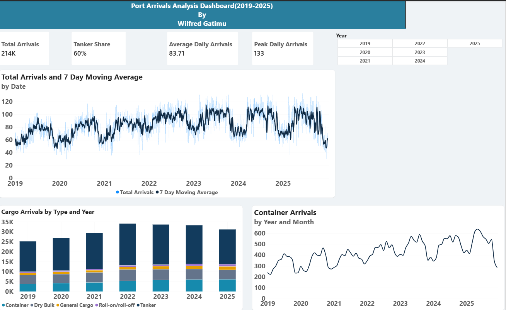
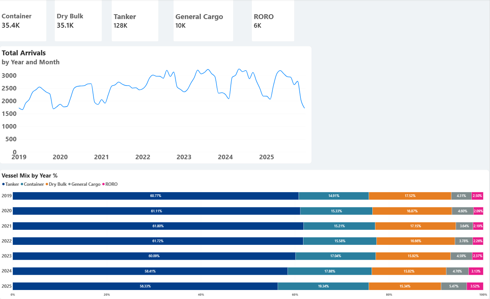
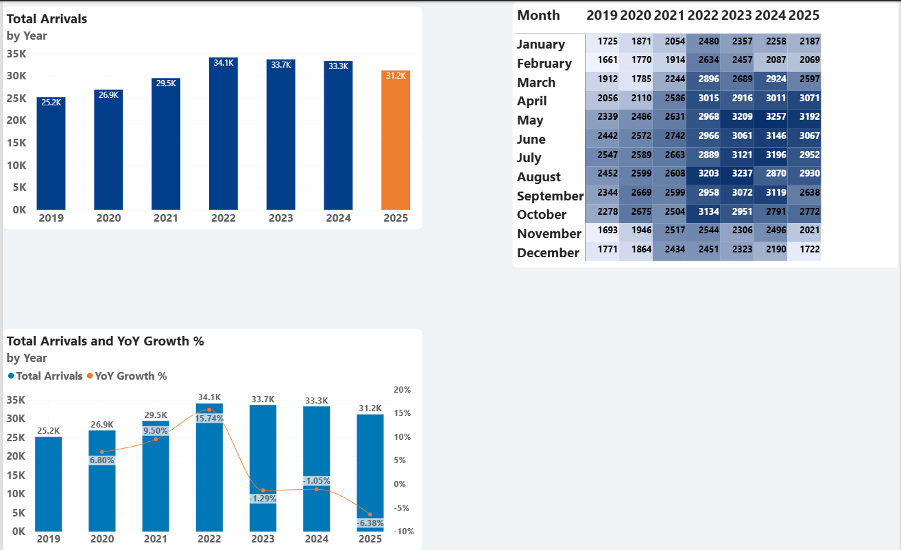
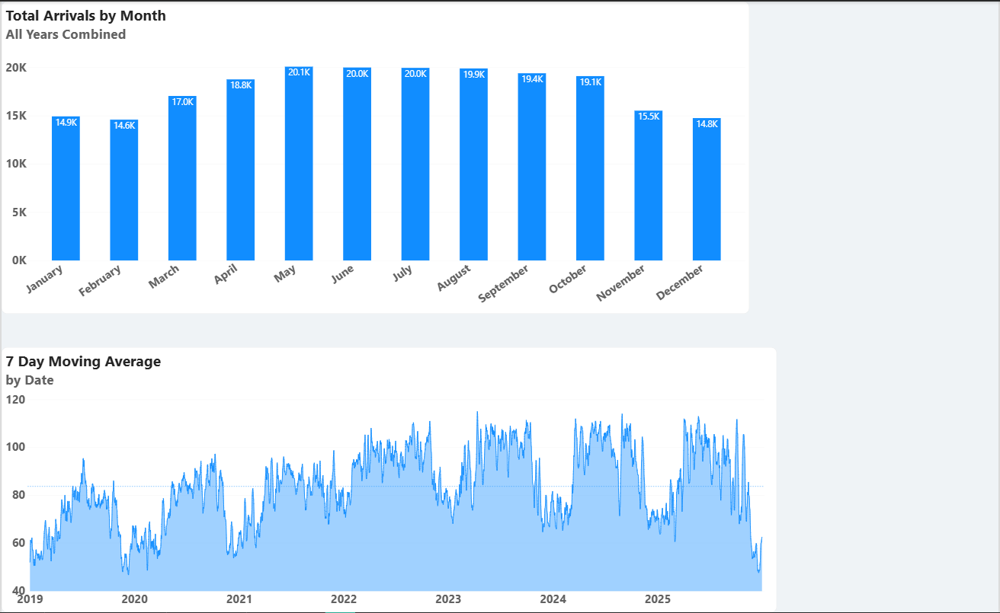

# Port_Arrivals
End-to-end analysis of 214K vessel arrivals (2019-2025) using IMF PortWatch data. SQL for cleaning, time-series analysis, Power BI for DAX, KPIs dashboard, 83.71 avg daily arrivals, Tankers ∼60% of total.
# Port Arrivals Analysis | 2019 - 2025

End-to-end analytics project analyzing global maritime activity using IMF PortWatch data.

**214K vessel arrivals. 83.71 arrivals per day. One clear story about global maritime activity.**

## Project Overview

This project transforms daily vessel arrival records into actionable insights using MySQL and Power BI.

It covers trend analysis, vessel composition, year-over-year growth, and time-series patterns from 2019 to 2025.

## Dataset

**Source:** IMF PortWatch - Open-source maritime activity data derived from AIS satellite information.

**Coverage:** 2019 - 2025
**Total Records:** 214,000+ vessel arrivals

## Tools Used

- **MySQL:** Data exploration, cleaning, transformation, aggregation, time-series analysis, window functions
- **Power BI:** Data modelling, DAX measures, KPI development, interactive visualizations, dashboard design
- **Power Query:** Data cleaning and transformation
- **Excel:** Data validation and checks

## Key Findings

- **214K** total recorded arrivals
- **83.71** average daily arrivals
- **133** peak daily arrivals
- **Tankers accounted for approximately 60%** of total arrivals
- **Container arrivals** showed changing seasonal patterns, with notable growth from 2023

## Vessel Types Analyzed

- Tanker
- Container
- Dry Bulk
- General Cargo
- Roll-on / Roll-off (RoRo)

## Analysis Performed

- Annual and monthly trend analysis
- Year-over-year growth
- 7-day moving averages
- Daily arrivals pattern
- Vessel composition and share
- Seasonal patterns by vessel type

## Dashboard Preview

### Port Overview

### Trends & Vessel Mix

### Yearly Totals

### Port Page 4

## Repository Structure

- `Ships_Arrival.sql` - SQL queries for cleaning, transformation, aggregation and analysis
- `Ships_Arrivals.pbix` - Power BI dashboard file
- `Port_Overview.png` - Main dashboard screenshot
- `Trends_Vessel_Mix.png` - Trends and vessel composition
- `Yearly_Totals.png` - Yearly totals view
- `Port_pg_4.png` - Additional dashboard view

## Key SQL Concepts Used

- Data cleaning and transformation
- Aggregation and GROUP BY
- Window functions
- Time-series analysis
- 7-day moving average
- Year-over-year comparison

## Key DAX Measures Used

- Total Arrivals
- Average Daily Arrivals
- Peak Daily Arrivals
- Tanker Share %
- Year-over-Year Growth

## What I Learned

- Working with large datasets (214K+ records)
- Performing time-series analysis
- Translating raw data into meaningful business insights
- Building KPIs and DAX measures in Power BI
- Designing dashboards for decision-making

## Connect

**Author:** Wilfred Gatimu

Open to connecting with Data Analysts, BI Developers and teams working on data-driven decision-making.
